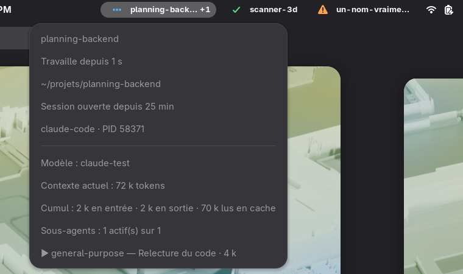

# AgentPerch

A GNOME Shell extension that shows your Claude Code sessions in the top bar: which
one is working, which one is done, and which one is waiting for you.



**Status: early.** Claude Code only, GNOME Shell 50 only, and the interface is in
French for now.

> AgentPerch is an independent project, not affiliated with or endorsed by
> Anthropic. It reads Claude Code's internal files (`~/.claude/sessions/` and
> `~/.claude/projects/`). Their format is undocumented and can change with any
> Claude Code release. Values were observed on Claude Code 2.1.317. An unrecognized
> status shows as a yellow question mark instead of breaking. Claude and Claude Code
> are trademarks of Anthropic.

| Icon | Meaning | Source `status` |
|---|---|---|
| Orange warning sign | Waiting for you: a permission prompt or a question | `waiting` |
| Blue dots | Working | `busy` |
| Light blue gear | Turn finished, a background command is still running | `shell` |
| Green check | Idle | `idle` |
| Yellow question mark | Unrecognized status, raw value shown in the menu | anything else |

## Features

- One icon per session, or a single icon showing the most urgent state and the
  number of sessions.
- A `+n` badge for running subagents.
- In the menu: state and duration, folder, model, current context size, cumulative
  tokens, and the list of subagents.

Options are in the extension preferences:

```bash
gnome-extensions prefs agentperch@tom-berthoud.github.io
```

## Privacy

Everything stays on your machine: the extension makes no network requests.

Session transcripts contain your conversations. AgentPerch reads them only while a
menu is open, and only if token usage is enabled. It keeps token counts and the
model name, never message content.

With subagents enabled, it also reads their metadata files every few seconds, even
with menus closed, and checks the modification time of their transcripts without
opening them. Subagent descriptions are task text written by the model: they stay
in memory and appear in the menu.

The `.key` files in `~/.claude/sessions/` and Claude Code's credentials are never
opened.

## Install from source

```bash
git clone https://github.com/tom-berthoud/agentperch.git
cd agentperch
./scripts/dev.sh link
```

On Wayland, GNOME Shell only detects a new extension or new code after you log out
and back in. Then:

```bash
gnome-extensions enable agentperch@tom-berthoud.github.io
```

The code runs inside the GNOME Shell process, so a serious bug can affect your
session. To follow the logs:

```bash
journalctl --user -f -o cat /usr/bin/gnome-shell
```

## Tests

Unit tests:

```bash
./scripts/dev.sh test
```

Integration test, in an isolated headless GNOME Shell with its own `HOME`, D-Bus
bus and fake sessions (needs `jq`):

```bash
./scripts/dev.sh check
```

## License

[MIT](LICENSE)
